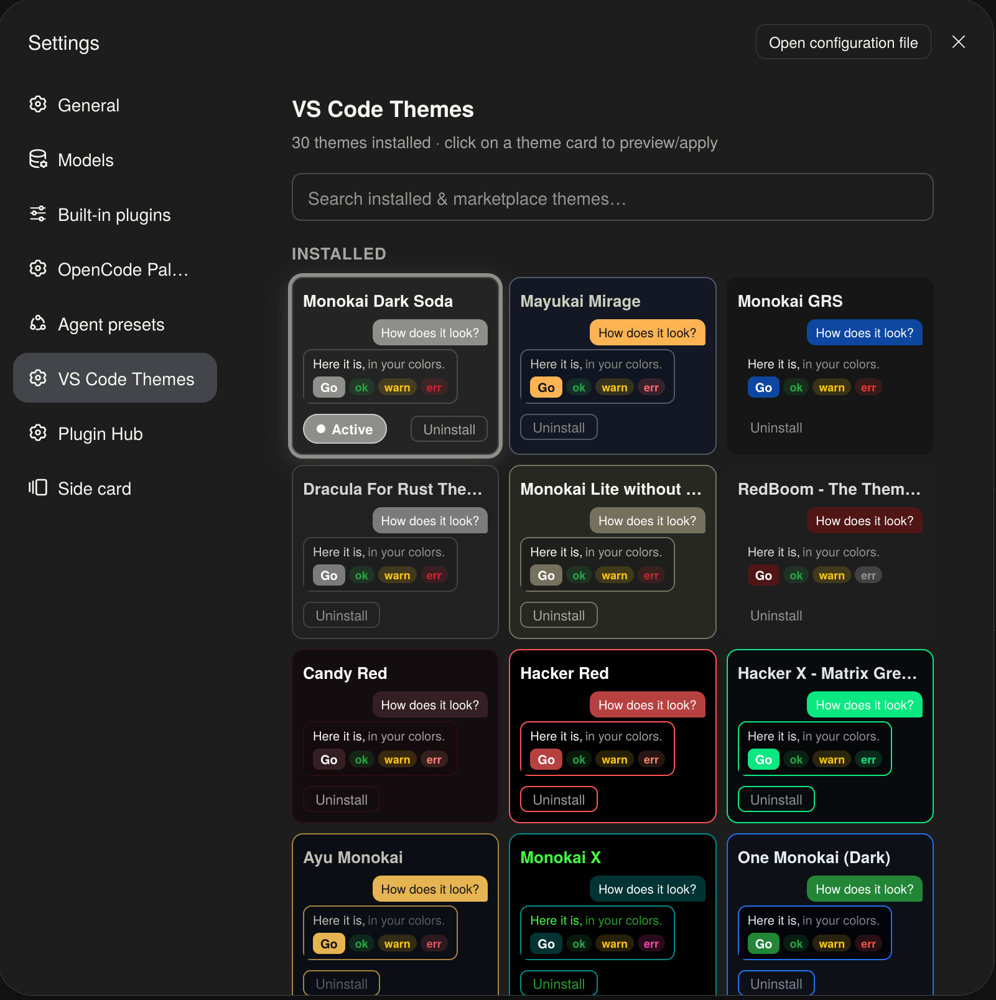

# VS Code Themes for DeepSeek Harness

Browse, search, install, and apply VS Code color themes to the DeepSeek Harness (DSH)
Web UI — one click re-skins the whole interface live, in that theme's own palette.

**Category:** UI & Experience · **License:** MIT · **Works with:** DSH 0.2.1-alpha.1 (web profile)

## What it does

- Adds a **"VS Code Themes"** section to **Settings** in the Harness Web UI.
- Bundles a curated catalog of **14 popular VS Code themes** (One Dark Pro, Dracula,
  GitHub Light, Nord, Catppuccin Mocha, Tokyo Gogh Alt, Monokai Classic, Solarized,
  Kanagawa, Palenight Italic, Kimbie Dark, …), each with a **live color-swatch
  preview** rendered in that theme's own colors.
- A single **search** filters local themes (installed + bundled) and simultaneously
  queries the official **VS Code Marketplace**. Marketplace hits appear in their own
  section with a live swatch and an **Install** button.
- **One-click install** downloads the theme's `.vsix`, extracts its color palette, and
  maps it onto the DSW design tokens. Installed themes persist across restarts and sort
  to the top (most recent first).
- Clicking any card **applies the theme immediately** — the whole UI re-skins live.
  Your selection persists across restarts (browser `localStorage`).
- A theme that fails to download, parse, or map (e.g. format incompatibility) shows a
  **visible error** and is otherwise left alone — it never breaks the plugin or the
  rest of the UI.
- Every card — surface, preview, pill, ring, and buttons including hover states — is
  themed in **that theme's own palette**, so the gallery reads as a faithful preview no
  matter which theme is currently applied.

## Screenshots

The panel in a real browser, with marketplace themes installed (30 installed above).
Each card previews its theme live (sample text, semantic chips, accent button); the
applied card carries the Active ring + pill in its own accent colour:



## Install

From a DSH profile (e.g. the default `web` profile):

```bash
dsh plugin --profile web add github:zxbc/dsh-vscode-themes2
```

Or from a local clone:

```bash
dsh plugin install /path/to/dsh-vscode-themes2
```

> The package is named `@local/dsh-vscode-themes2` — the trailing `2` is historical
> (an early specifier got cached as failed inside a running harness process during
> development) and is part of the install name; don't "fix" it when typing commands.

## How it works

This is a **two-half** DSH plugin: the browser is network-restricted, so everything
that talks to the VS Code Marketplace runs in the **host half** and is exposed to the
browser through a `TypertRemoteService` named `vscodeThemes` (self-mounted by the
client via `ctx.remote.$mount`).

- **Browser half (`client.js`)** — renders the settings section, registers themes with
  `ctx.theme.register({ id, colorScheme, tokens })`, applies the persisted selection on
  load, and persists state in `localStorage` (`dsh.vscodeThemes.selected`,
  `dsh.vscodeThemes.installed` — JSON array, most recent first).
- **Host half (`index.js` + `marketplace.js`)** — exposes `search(query)` and
  `fetchTheme(ext)` on the remote service, delegating to the pure, unit-testable logic
  in `marketplace.js` (no Cordis wiring).

Search queries the official VS Code Marketplace gallery API (themes category only);
install downloads the theme's `.vsix` from the publisher's `gallery.vsassets.io` CDN,
parses the ZIP in-process, and reads the theme's JSONC color definitions (which are
stripped of comments/trailing commas before parsing). See PROGRESS.md for the full
protocol facts and edge cases.

## Permissions & external services

- **Outbound network (host half only):**
  - `POST https://marketplace.visualstudio.com/_apis/public/gallery/extensionquery` —
    theme search, only when you type a query (2+ characters).
  - `GET https://{publisher}.gallery.vsassets.io/…vspackage` — `.vsix` download, only
    when you explicitly click Install.
- **No telemetry, no other network calls.** All parsing and token mapping happens
  locally in the host process.
- **Browser state:** `localStorage` only (`dsh.vscodeThemes.*`). Nothing is uploaded.

## Compatibility

- **DSH 0.2.1-alpha.1**, web profile (the client half is injected into the Web UI).
- **Host half: Node 18+** (uses `DecompressionStream` to unzip `.vsix` files).
- Known limitation: marketplace themes without a parseable
  `editor.background` / `editor.foreground` are skipped with a visible error message.

## For developers

[`PROGRESS.md`](PROGRESS.md) is the project's development log: architecture notes,
marketplace protocol facts, the critical contracts and pitfalls, and the session log.
It is agent-maintained — read it before changing `client.js` or `marketplace.js`.

### Files

| File | Purpose |
|---|---|
| `index.js` | Host half: `VscodeThemes` remote service (`search` / `fetchTheme`). |
| `client.js` | Browser half: theme catalog, marketplace search UI, install, persistence, settings UI. |
| `marketplace.js` | Pure host logic: marketplace search, vsix fetch/parse, token mapping. |
| `cordis.patch.yml` | Inserts the `vscode-themes2` entry into the profile tree. |
| `locale/en.json` | Display title/description for the Plugin Manager. |
| `icon.svg` | Plugin icon. |
| `screenshots/` | Gallery screenshot embedded in this README. |
| `PROGRESS.md` | Development log & session notes. |

## License

[MIT](LICENSE) — see the [LICENSE](LICENSE) file.
